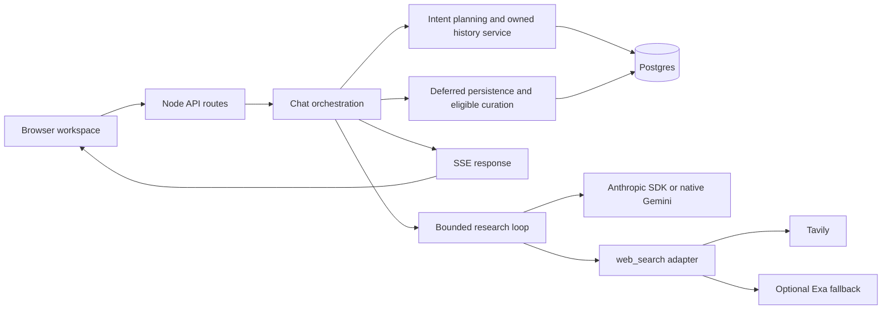

# Runtime architecture

This document describes the current application. [README](../README.md) owns
setup and commands; [DESIGN](DESIGN.md) explains the decisions and tradeoffs.

## Runtime and boundaries

Chrona is one strict-TypeScript Next.js App Router application. React renders the
UI; Node route handlers own provider keys, inference, web search and Postgres
access. APIs use the Node runtime and dynamic responses, never Edge. Cache
Components and Partial Prefetching are disabled in the current configuration.

Anthropic uses `@anthropic-ai/sdk`; Google AI Studio uses the native Gemini
transport. Both share the handwritten answer loop. Structured recall planning
and curation are tool-free inference calls. The answer model's entire tool
surface is `web_search`; provider extraction and fallback are internal functions.

## Module map

| Area | Responsibility |
|---|---|
| `app/` | Pages, root layout, global design tokens and Node API entrypoints |
| `components/` | Workspace, chat, composer, history, menus, dialogs, source rendering and shared Lenis behavior |
| `lib/chat.ts` | Validation, request admission, routing, response composition, persistence and completion traces |
| `lib/clock.ts`, `lib/calendar-context.ts` | Injected calendar/elapsed time and date context |
| `lib/recall/` | Temporal ranges, general context recall, deterministic inventories, semantic planning and history evidence |
| `lib/agent/` | Prompt assembly, native model transports, handwritten loop, cancellation, recovery and SSE events |
| `lib/tools/` | Search fan-out, cache, result normalization, source limits and provider adapters |
| `lib/store/` | Drizzle schema, pool lifecycle, migrations, scoped queries, curation, recall references and snapshot transfer |
| `lib/curator/` | Tool-free extraction, output validation and retryable job processing |
| `test/` | Shared fixtures, API checks and isolated Postgres database lifecycle |
| `evals/` | Recorded and live evaluation entrypoints, synthetic fixtures and independent answer checks |
| `scripts/` | Focused provider smoke checks and fresh-container shipping verification |

## Request lifecycle

The chat handler validates JSON, timezone, model selection, effort and anonymous
cookie identity before acquiring per-user admission. It creates a request UUID
for tracing and begins saving the user message. Inference waits for that write
to succeed. The response's strict timestamp/ID boundary excludes the new message
and any future records from recalled history.

Request routing has three distinct paths:

| Path | Retrieval and generation |
|---|---|
| Message inventory | Structured collection plan, owned user-message pages and deterministic local rendering; no answer generation, web search or curation |
| History-only | Structured plan; inventories read fresh user-message pages, summaries use bounded tool-free grouping, topical recall uses semantic selection and checked quotes/timestamps |
| General or mixed research | General context recall or verified historical baselines, followed by the answer loop and the single web-search tool |

Mixed requests render private-history facts from records and send the external
subquestion to research. The generated external answer is buffered before the
combined text is emitted. History and mixed answers skip curation. General
research can stream model text as it arrives; live sports answers use a separate
buffered date/status review path.

All requests use one structured interpretation path. Collection mode separates
new date/session scopes, previous exact collections and explicit all-history
requests. Current dates are resolved independently of the plan so omissions never
silently remove a filter. Broad inventories bypass topical selection; each
message's own timestamp determines its day, independently of session creation.
Summaries produce one item per selected message with bounded earlier same-session
user context, including across midnight. Context does not enter selected-day
counts. Exact displayed source IDs and absolute scope persist atomically in
`recall_references.collection`. Follow-ups rehydrate that set; missing/deleted
provenance requires a new request. Selected/context originals are re-read after
synthesis. Dates, times, counts, ownership and scope remain in plain functions
and SQL; the answer model still sees only `web_search`.

The request registers `after()` while the Next request context is active. That
task waits for stream completion, saves the exact emitted assistant text and
associated recall references or curation job, releases request admission, then
runs eligible extraction. Partial output after cancellation or provider errors
can still be persisted. A completion trace records persistence outcomes.

## API and stream contract

| Endpoint | Input | Output |
|---|---|---|
| `POST /api/chat` | `message` (1–20,000 characters); optional UUID `sessionId`, `tz`, `selection: { provider, model }`, `effort` | SSE; anonymous identity/conversation cookies |
| `GET /api/history` | Optional `sessionId`, `tz`, `limit` (1–200), opaque `before` | `sessions`, `nextCursor`, `activeSessionId`, `now`, `tz` |
| `DELETE /api/history?sessionId=<UUID>` | Owned conversation UUID | 204 on successful/idempotent deletion; active-response protection and sanitized failures |
| `GET /api/models` | No secret input | Default selection, configured model IDs and provider availability |

History uses timestamp/ID keyset pagination and groups each returned page into
sessions and local calendar days. A page is a window of history, not a claim that
every conversation was loaded. Clients merge pages by stable IDs. Responses are
private and non-cacheable; individual history turns omit ownership IDs and
generated search vectors.

The POST response uses `text/event-stream` with no-transform/private cache
headers. `X-Session-Id` identifies the conversation; `X-Turn-Id` and
`done.turnId` are the request UUID, distinct from numeric database turn IDs.

| Event | Payload |
|---|---|
| `status` | Search batch ID, kind, query strings, running/done state and result count |
| `sources` | Source URL, title, domain, publication date and official-domain flag |
| `delta` | Answer text fragment |
| `error` | Sanitized user-facing failure message |
| `done` | Request `turnId`, `ttftMs`, `totalMs` |

The browser uses the fetch body stream rather than EventSource because chat is a
POST with JSON and cancellation. The parser handles split UTF-8 and event
boundaries; the reducer preserves partial text and terminal states.

## History evidence and calendar handling

The history service searches original user messages with ownership and role
filters inside SQL. It combines up to three full-text variants and bounded
chronological candidate pages. Neighboring messages supply context, while only
original user quotes can support assertions about a past request. The service
rechecks selected records after inference, reports incomplete coverage and
renders stored timestamps in the requested timezone.

`recall_references` connects an assistant answer to its request and selected
source user turns. Timestamp follow-ups rehydrate those IDs and reject deleted
or out-of-scope originals. Empty references block stale antecedents. Pure history
requests cannot become subsequent topical evidence of the request they describe.
See [conversation recall](MEMORY_RECALL.md) for limits and failure behavior.

Calendar functions receive an injected reference instant from `lib/clock.ts`.
Historical ranges use inclusive start/exclusive end UTC boundaries derived from
local calendar midnights. `NOW_OVERRIDE` freezes calendar time for evaluations;
the separate monotonic timer still advances for deadlines. Ambiguous numeric
dates require clarification; historical and upcoming-event conventions are kept
separate.

## Storage and lifecycle

The only database driver is Drizzle node-postgres over `pg.Pool`. `DATABASE_URL`
is required. Node instrumentation awaits automatic migration readiness, and
development reloads reuse the pool while applying newly pending migrations and
rebinding query methods. The startup connection timeout is bounded and failures
are sanitized.

| Table | Purpose |
|---|---|
| `turns` | Original user/assistant messages, timestamps, timezone and generated English search vector |
| `claims` | Source-linked historical values, source URLs, as-of dates and supersession links |
| `memory` | User-scoped durable facts with source-turn attribution |
| `threads` | User-scoped topic summaries with source attribution |
| `curations` | Persisted extraction jobs and bounded source evidence |
| `recall_references` | Verified history sources, request/answer linkage and history-only flag |
| `web_agent_migrations` | Applied migration versions |

Append-only SQL migrations are authoritative. Transactions and advisory locks
serialize startup, user-memory updates and deletion where appropriate. The GIN
index serves full-text queries; user/timestamp indexes support date ranges and
cursors. Queries require server-supplied user identity and parameterize values.
Claims also check ownership of their linked turns.

Deletion removes the owned session and linked derived records in one transaction,
clears surviving references to removed claim versions, and prevents delayed
curation from recreating deleted notes. The UI removes pins and stale history
pages and opens a new chat when the active conversation is deleted.

Local Postgres 18 runs on localhost port 5432 with a named volume. The separate
test service uses port 5433 and disposable storage. Tests allocate uniquely named
databases only on that test service. No embedded fallback exists. The snapshot
importer verifies saved schema-version 1–5 data before committing it to an empty
target; local cutover backups and exports remain in ignored `data/`.

## Search, inference and extraction

`web_search` accepts 1–6 queries per tool invocation and optional recency,
`since`, topic, official-source preference and fast/deep depth. Per-request effort
can impose a smaller remaining quota. Tavily is primary; Exa is used only when
configured as fallback. Search handles concurrency, timeouts, deduplication,
bounded content, date normalization and cache expiry internally.

The answer loop caps calls, queries, sources, context and elapsed time. Planning,
recall and synthesis share the request's time budget. Final/recovery calls disable
additional tools. A bounded recoverable failure may synthesize from existing
results without repeating search. Native provider errors are categorized and
sanitized. Search content is untrusted data, not instructions. See the
[design budget table](DESIGN.md#batched-search-and-bounded-inference).

Live-score requests bypass the application cache and retrieve fresh page content.
Two search passes are allowed. Venue dates, user-local dates, source publication
times and retrieval timestamps retain separate meanings. Calendar review can
make one bounded correction; missing or conflicting evidence stays unverified.

The curator has no tools. Anthropic uses Haiku; Gemini uses the selected model.
It validates structured output, supporting quotes and source membership before
transactional merges. A pass processes at most two jobs with six-second call
timeouts and a twelve-second overall deadline. Failed jobs remain pending for a
later eligible turn. The comparison/date gate supports conservative claim
supersession; arbitrary generated research prose remains model-dependent.

## Frontend and scrolling

The workspace owns loaded sessions, selected conversation, model and effort
preferences, pins, offline state and in-flight history requests. The chat reducer
owns messages and streaming state. The composer resizes up to its height cap;
menus and native dialogs preserve focus and Escape dismissal.

Global CSS supplies shared light/dark tokens and hides scrollbar chrome while
retaining overflow. The root Lenis instance and `useSmoothScroll` manage
independent message, history, demo, picker and dialog panels. Each instance is
destroyed on unmount. Native keyboard/touch/input behavior and reduced-motion
preferences remain supported. Auto-follow uses immediate Lenis target updates;
manual upward reading pauses it, and Jump to latest resumes it smoothly.

The demo uses the same message rendering, SSE parser, reducer and scroll behavior
with in-browser fictional fixtures. It does not make model/search requests or
persist conversations.

## Configuration, traces and validation

`lib/env.ts` validates the configuration listed in [`.env.example`](../.env.example).
Secrets stay on the server. Anonymous HttpOnly cookies provide continuity, not
account authentication. Per-process admission allows one active turn per user
and ten per minute by default; it is not a distributed rate limiter.

Completion traces record request/turn IDs, timing, query count, persistence,
provider failure categories and recall intent/evidence/coverage. Full private
messages, provider bodies, keys and connection strings are not trace inputs.

`npm test` covers plain functions, mocked transports and real Postgres integration.
`npm run eval` checks the production chat flow with recorded models and synthetic
sources. Paid checks remain separate. `npm run ship:verify` runs a source-only
working-tree snapshot in fresh Node/Postgres Linux containers, including dev and
production HTTP persistence checks. Read [README](../README.md) for exact commands
and [DESIGN](DESIGN.md#evidence-for-the-design) for measured evidence and limits.
