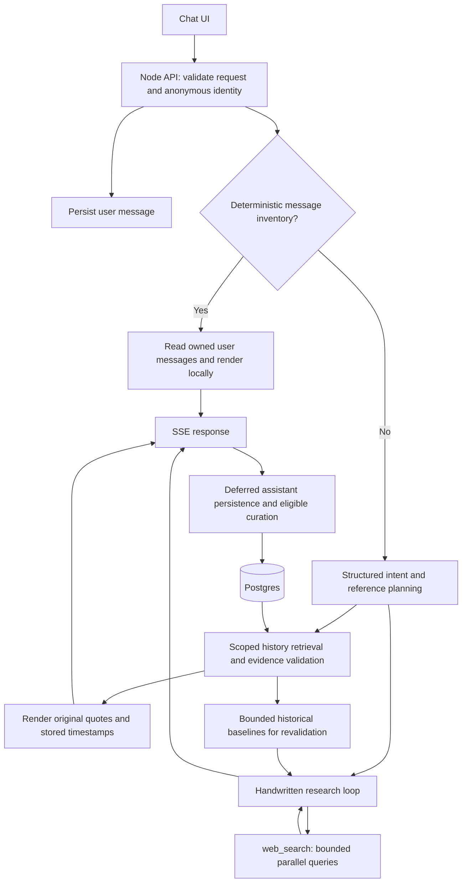

# Chrona: design decisions

Chrona combines two evidence problems: remembering what a user actually asked,
and checking what is true now. Original messages establish conversation history;
dated external sources establish current facts. A past assistant answer supplies
a reported baseline to recheck. A summary or an unsupported recollection cannot
substitute for either kind of evidence.

The design gives models interpretation and synthesis while keeping identity,
storage, calendar arithmetic, provenance checks, budgets and persistence in plain
functions. The answer model sees exactly one tool, `web_search`. The application
uses native provider transports and a handwritten loop rather than a framework.

## One application with explicit execution boundaries

Next.js serves the UI and Node API routes in one TypeScript project. The routes
remain dynamic; Cache Components and Partial Prefetching are disabled to match
the installed Next.js configuration and route conventions. Browser state handles
drafts, preferences and rendering, while keys and database access remain on the
server. Node instrumentation waits for storage initialization before requests.

The user write must succeed before inference begins. The new request is excluded
from historical evidence using a strict timestamp/ID boundary. `after()` is
registered inside the request context, waits for the response outcome, and saves
the exact assistant text sent to the client, including partial text after failure
or cancellation. Request admission remains held until persistence finishes;
curation does not hold that lease.

This keeps persistence and interpretation understandable in one process. A
separate service or worker becomes useful when independent scaling or durable
background execution is required, rather than as a prerequisite for the current
local application.

## Semantic interpretation with deterministic history evidence

Unqualified message inventories use a dedicated query and renderer. Other
requests use structured planning to classify `general`, `history` or `mixed`
intent, select a history operation and resolve references from bounded recent
context. Planning exposes no tools and adds inference cost to ordinary requests.

History questions search original user messages first. A model selects semantic
matches; application code checks ownership, chronology, candidate IDs, exact
quotes and date/session scope, then re-reads selected sources before rendering.
Summaries, derived memory and assistant assertions are never evidence of what
the user asked. A valid ID and quote still do not prove semantic entailment, so
the design retains ambiguity, uncertainty and live-model regression checks.

Postgres full-text retrieval combines up to three topical query variants and
bounded pages. Revalidation includes a topic-only variant because prices or
other attributes may exist only in the adjacent assistant answer. Mixed-question
planning preserves output format, source restrictions, fictional context and
search-budget instructions while separating the fresh external question.

Source IDs persist atomically with the assistant answer. Timestamp follow-ups
reuse those originals and recheck deletion and ownership. Failed or ambiguous
recall records an empty source set instead of reviving an unrelated older answer.
History-only recall requests are excluded from later topical searches to avoid
self-confirmation. Mixed requests remain candidates because they can contain a
genuine new external question.

History-only answers render stored quotes and local timestamps without web search
or free-form answer synthesis. Mixed answers compose a validated history section
with external research and provide bounded original baseline text for
revalidation. Generated mixed-answer text is buffered until research completes.
Both paths skip curation so generated recollections cannot become new durable
memory. A miss means no supported message was found within the searched scope;
it does not establish that the conversation never happened.

General research retains a separate context-recall path: dated turns, bounded
keyword fallback, claims, memory and thread summaries. Independent reads run
concurrently. Fetched transcript pairs stay together under a 6,000-byte default
context budget, and claims are omitted when their source turn is omitted.
Derived memory is labeled as context, not proof of a past question. This path
does not provide the stronger provenance contract of explicit history answers.

## Injected clocks and explicit calendar semantics

`lib/clock.ts` supplies calendar time and a separate monotonic timer. Calendar
overrides make temporal tests reproducible without freezing elapsed-time budgets.
Date construction is centralized; parsing and comparison receive their reference
instant rather than consulting the system clock independently.

Historical weekdays are past-biased, and date ranges include local midnight at
the beginning and exclude midnight after the final day. Boundaries convert to
UTC independently, preserving 23- and 25-hour daylight-saving days. Explicit
years remain explicit. Ambiguous numeric dates require clarification. Event and
upcoming-date interpretation remain separate from historical recall conventions.

The alternative is model calendar arithmetic, which is harder to reproduce and
can conflate user, venue and UTC dates. Revisit weekday/week-start conventions
when supported locales require different semantics, while retaining explicit
resolved dates in answers.

## One Postgres driver across environments

Drizzle's node-postgres driver and a `pg.Pool` serve local development, tests and
hosted deployments. `DATABASE_URL` is required and validated; local Postgres 18
runs in Docker with a persistent named volume and a localhost-only port. The
embedded fallback and its dependency have been removed.

Handwritten, append-only SQL is the migration authority. It preserves the
generated English `tsvector`, GIN index and other schema features explicitly.
A transaction, advisory lock and migration ledger make concurrent startup and
repeat initialization safe. Failed initialization closes the pool and reports a
sanitized error. Development reloads reuse the connection while refreshing
queries and applying newly pending migrations.

A separate disposable Postgres service and uniquely named databases isolate test
cleanup from application conversations. A snapshot importer requires an empty
target, preserves PostgreSQL text values for bigint IDs and timestamp precision,
restores links, verifies transferred data and resets sequences transactionally.
The local cutover retained the original database and ignored backups/exports.

One real SQL implementation avoids maintaining two full-text and migration paths.
The cost is a running database service. Revisit storage only for a concrete
environment constraint; do not silently restore an embedded fallback.

## A dated ledger and conservative comparison

The ledger stores attributed historical claims independently of prose summaries.
`diffClaim` compares canonical values; `revalidateClaim` additionally requires a
publication time strictly after the baseline and no later than the injected
current instant. Missing, stale, same-instant or future evidence dates force an
unknown verdict, including when the numeric values match.

Comparison preserves decimal precision, currency, units and billing commitments.
Monthly and annual offers are not treated as interchangeable. Storage units,
quantities, versions and booleans have explicit normalization rules; incompatible
or conflicting values remain unknown. The parser does not perform currency
conversion or infer arbitrary prose meaning. Evidence selection must isolate the
relevant subject and attribute before comparison.

The general research loop is not a universal deterministic verdict gate: its
arbitrary prose still depends on model interpretation and prompt policy. The pure
comparison/date gate is used where evidence is explicitly selected, including
curator supersession and evaluation assertions. This boundary avoids claiming
that every generated research sentence is mechanically verified.

## Deferred curation with source provenance

Eligible research answers save their extraction job with the assistant turn.
After streaming and persistence, a tool-free curator extracts claims, durable
user facts and topic summaries. Anthropic uses Haiku; Gemini uses the selected
Gemini model. Strict schemas, source URL membership and supporting excerpts are
checked before writes. Summaries remain interpretations, not historical proof.

Each pass processes at most two jobs, reserves capacity for the current answer,
and uses bounded per-call and overall deadlines. Failed jobs remain available
for later eligible turns. Transactional merges and per-user advisory locks
prevent duplicate/concurrent updates and serialize extraction with deletion.

Conversation deletion removes the selected user's session and source-linked
records atomically. Invalid cross-record references roll the transaction back.
Deleting a source prevents delayed curation from recreating its notes.
Revisit a dedicated durable worker when hosting or throughput requires retries
independent of an application response lifecycle.

## Batched search and bounded inference

`web_search` accepts a query array and search preferences. Tavily is primary;
Exa is an optional configured fallback. Fan-out, concurrency, cache expiry,
deduplication, page extraction and output truncation are ordinary functions
behind that one model-facing contract. Deep content retrieval is a provider
option rather than another tool.

Returned pages and recalled content are escaped, bounded data, never
instructions. Failed queries preserve successful results. Publication dates and
retrieval times remain distinct. A successful search does not by itself verify a
claim. Live-score requests bypass the app cache, request fresh page content,
stop after two search passes and retain uncertainty about missing or conflicting
timestamps. Sports calendar review can correct one date/status contradiction
within the existing budget.

The research loop bounds answer-model calls, queries, sources, context and wall
time. Final and recovery calls disable further tools. One short recovery may
reuse existing evidence after a recoverable provider failure; it does not repeat
searches. Authentication and rejected requests are not silently retried. Numeric
Retry-After delays must fit the remaining budget. Cancellation aborts ongoing
work, and terminal output remains explicit about unavailable evidence.

| Effort | Queries | Sources | Answer-model calls | Request time | Final reserve | Output tokens per answer call |
|---|---:|---:|---:|---:|---:|---:|
| Instant | 2 | 2 | 3 | 30 s | 8 s | 1,024 |
| Medium | 5 | 5 | 4 | 45 s | 10 s | 2,048 |
| High | 10 | 10 | 4 | 90 s | 15 s | 4,096 |

Planning and evidence selection consume the same request time budget but are
separate from the answer-model-call count. Source counts are caps, not quotas.
Stable prompt content uses provider cache controls where supported; actual cache
hits depend on provider rules and reuse, and the app does not pad prompts to
manufacture them.

## A reading-focused interface

The UI uses Tailwind and shared CSS tokens with cream/light and charcoal/dark
palettes. Geist handles interface text, Source Serif 4 handles answers, and Geist
Mono handles code. The reading column is capped at 720px and the desktop sidebar
at 260px. The composer is centered for a new conversation and anchored below the
message viewport during a chat. Source chips, dates, verdict labels and search
activity remain distinct so color is never the only signal.

Theme selection applies before paint and follows the system when requested. A
native mobile dialog supplies focus management and dismissal for navigation.
The app provides visible keyboard focus, a skip link, labeled controls, offline
states, retries, stop/cancel controls and an explicit deletion confirmation.
Pinned chats, model choice and effort are browser preferences rather than
server-account settings. Title filtering covers loaded history, not a separate
whole-database semantic search.

Lenis controls the document and independently scrolling conversation, history,
demo, picker and dialog panels. Hidden scrollbar chrome keeps the reading area
clean without disabling overflow. Each instance is cleaned up on unmount;
resize observers track dynamic content. Nested panels own their wheel events.
Keyboard input, native touch, editing controls and Shift-wheel horizontal
scrolling remain available, and Lenis honors reduced-motion preferences.
Streaming auto-follow updates the target immediately, yields when the user reads
earlier text, and resumes through Jump to latest. A stable viewport class avoids
overwriting Lenis-managed classes when the empty view becomes a conversation.

The ASCII workspace background is a procedural glyph field with fixed coordinates
for hydration, a quiet reading center, SVG/CSS texture and a reduced-motion path.
The component demo shares real rendering and stream parsing
with fictional local fixtures; it makes no provider requests or storage writes.
The alternative to the shared UI behavior is separate demo-only logic that drifts
from the product. Keeping the same components makes visual checks representative.

## Observability, identity and failure boundaries

One completion trace joins request UUIDs to persisted turn IDs and records recall
time, first answer-text latency, query count, total response time, persistence,
provider failure categories and recall provenance/coverage. Trace construction
does not include full private messages, provider response bodies, API keys or
connection strings. Tool-call count and query count are different metrics.

HttpOnly, SameSite=Lax anonymous cookies provide local continuity. They are
Secure in production or over HTTPS, but are not signed-in account identity.
One active request per user and per-process rate admission protect sequencing;
they are not distributed account security. Direct database access, public
multi-user deployment, cross-device recovery and account management require
additional design work.

## Tradeoffs and conditions for revisiting them

| Decision | Benefit and cost | Alternative | Revisit when |
|---|---|---|---|
| Semantic planning with deterministic evidence checks | Handles references; adds latency and can miss candidates | Keyword-only routing | Measured cost outweighs recall quality for supported requests |
| Postgres full-text variants | Indexed and inspectable; weak on paraphrases | Hybrid/vector retrieval | Labeled paraphrase evals demonstrate unresolved candidate misses |
| Original-message provenance | Prevents summaries becoming fabricated memory; retains transcripts | Summary-only recall | Change retention policy when privacy requirements change, while keeping provenance checks |
| One search tool and handwritten loop | Explicit execution and cancellation; adapters need maintenance | Specialized tools or a framework | Product requirements explicitly change the tool constraint or justify framework complexity |
| Docker Postgres and one driver | Real SQL parity; database service required | Embedded storage | A supported environment cannot run the current database setup |
| Deferred persisted curation | Extraction stays off the response path; shutdown can interrupt work | Independent worker queue | Hosting guarantees or throughput require autonomous retries |
| Anonymous cookies and local admission | Simple local continuity; no account or distributed guarantees | Authenticated accounts, RLS and shared admission | The app is exposed to untrusted users or multiple serving instances |
| Lenis with native interaction fallbacks | Consistent wheel motion; adds client animation work | Entirely native scrolling | Measured responsiveness or accessibility needs favor native-only behavior |
| Recorded evals plus a small live check | Reproducible integration checks; limited model-quality evidence | Broad live benchmark | A release needs accuracy distributions or provider latency comparisons |

Vector storage, multi-agent orchestration, generic memory-writing tools, account
authentication, distributed caches/admission, a standalone curator worker and
automated production deployment are outside the current product. There is no
production application Docker image; the supported local app runs on the host
with Docker Postgres. Verification containers test that setup and are not a
production hosting artifact.

## Evidence for the design

`npm run eval` drives the production chat handler and real Postgres with a
calendar fixed at 15 November 2026 UTC, recorded models and synthetic sources.
The three example conversations, a missing-history case and query exhaustion
check original-message provenance, dates, baseline delivery, one search batch per
researched example, per-item verdicts/citations, undated uncertainty, budgets,
SSE termination and persistence. Oracle tests reject corrupted answers.

Reference Windows-host/Docker measurements from one completed recorded run:

| Scenario | Result | Recall ms | First text ms | Tool calls | Queries | Total ms |
|---|---|---:|---:|---:|---:|---:|
| Monday CRM shortlist | PASS | 76.68 | 151.55 | 1 | 5 | 151.59 |
| 3 November answer | PASS | 29.71 | 35.35 | 1 | 1 | 35.40 |
| Tuesday hosting comparison | PASS | 29.20 | 33.48 | 1 | 2 | 33.51 |
| Missing history | PASS | 4.88 | 7.68 | 0 | 0 | 7.74 |
| Query-budget exhaustion | PASS | 26.57 | 31.78 | 1 | 5 | 31.82 |

These are single-run observations, not percentiles or provider latency. The
monotonic timer measures real elapsed time while the calendar stays fixed.
Timings exclude fixture creation, migrations, teardown and deferred persistence
or curation. Mixed answers buffer generated text until research completes, so
first client answer text can arrive near total response time.

The restricted `eval:live` Gemini hosting fixture passed with 2,961 ms of recall,
8,697.31 ms to first answer text and 8,697.39 ms total, using one tool call and two
queries. Its request explicitly identifies fictional providers, synthetic
evidence, a table format and a single search batch. It is narrower than the
unmodified deterministic sample prompts and is not a production accuracy claim.

The latest recorded source suite contains 570 passing tests. Clean Linux
source-snapshot verification passed installation, dev and production startup,
build, lint, types, tests, sample-prompt evals and HTTP conversation persistence.
Following the Lenis change, normal Turbopack build, lint and typecheck passed;
browser checks verified desktop and 375px layouts, menus/drawer, keyboard access,
hidden scrollbars, auto-follow and reading-position preservation. These checks
were not a comprehensive browser, accessibility or load benchmark.

Reproduce with the commands in [README.md](../README.md). The clean verifier uses
fresh Node 24/Postgres 18 containers and a source-only snapshot, including
uncommitted source; private settings, local database files and installed/build
artifacts are excluded. Reports remain in ignored `data/ship-check/`. Images,
packages and build-time fonts require network access. Paid provider checks are
explicit opt-ins and never part of the ordinary test command.
