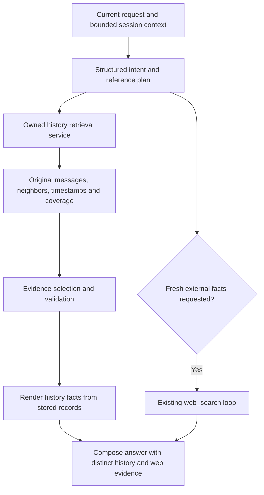

# Historical conversation recall audit

Audited 15 November 2026 against the working tree and the supplied screenshot.
This is a historical record of the pre-remediation snapshot, not the current
runtime specification. Source-line references, reproduced defects, infrastructure
and recommendations below refer to that snapshot. The audit's temporary tests
were removed because they asserted the old defects. Current behavior is described
in the [recall contract](MEMORY_RECALL.md), [architecture](ARCHITECTURE.md) and
[design decisions](DESIGN.md).

## Current resolution status

The later [collection follow-up audit](RECALL_FOLLOWUP_AUDIT.md) checked the saved
records behind the new screenshots. It confirmed lost collection provenance and
missing same-session context: the after-midnight message was selected but its
subject was misrepresented. Collections now persist exact displayed sources and
absolute scope; the single structured planner distinguishes references from new
or all-history inventories. Summaries receive bounded earlier user context and
must return one scalar source ID per item. The earlier shortcut/empty-collection
behavior described in the first follow-up resolution below is superseded.

The follow-up screenshot audit on 16 November 2026 identified a separate
inventory/summary routing gap: a broad yesterday inventory used fresh pages,
while a today summary reached topical selection and could produce a false miss.
Broad structured list/summary plans now share the fresh user-message inventory.
Summary synthesis validates source coverage, groups repeats and falls back to
originals on failure. Fixed runtime prompt date examples were removed; calendar
format examples derive from the injected clock. Regression fixtures vary year,
timezone, leap-day and New Year boundaries rather than encoding screenshot dates.
The follow-up change passed 590 source tests, five deterministic evaluations,
TypeScript and lint checks. Current Windows production-build verification hits
a Turbopack CSS-worker startup failure even outside the sandbox. Paid live-provider
summary evaluations were added but not run.

| Historical concern | Current behavior and evidence |
|---|---|
| Keyword-only intent and pronoun handling | Structured planning classifies history/general/mixed intent and resolves bounded references |
| Assistant assertions or summaries treated as proof | Original user-message candidates, exact quote/ID checks and deterministic history rendering |
| Recall questions confirming themselves | History-only requests are excluded from subsequent topical history searches |
| Missing timestamp antecedents or deleted sources | Persisted source references are rehydrated and rechecked for ownership, scope and deletion |
| Oversized assistant text removing all user evidence | User-first history candidates retain relevant original excerpts independently of answer size |
| Unreported retrieval omissions | Bounded pages and explicit candidate coverage; misses do not establish that the user never asked |
| Private-history questions drifting into web research | History-only routing skips web search and answer synthesis; mixed requests keep evidence sections separate |
| Query variants requiring attributes absent from the user message | Revalidation guidance includes a topic-only variant; mixed planning preserves answer/source/budget constraints |
| Limited regression and latency evidence | Full Postgres suite, five deterministic evaluation cases, focused recall checks and a restricted Gemini live fixture |
| Former embedded storage and a temporary CSS build failure | One node-postgres driver with Docker Postgres locally; regular Turbopack production build now passes |

The historical audit used PGlite; current runtime, integration tests and evals use
real Postgres, with no embedded fallback or dependency. Current validation records
570 passing source tests, deterministic evaluations, clean Linux source-snapshot
verification, and subsequent Lenis UI build/browser checks. These are regression
results, not proof of general model accuracy. The original screenshot incident
still cannot be reconstructed conclusively without its original saved turns and
request trace. The recommendations that follow are retained as audit provenance;
their implemented contract is documented in the current files linked above.

## Historical context

The screenshot demonstrates a confident recollection, followed by an unsupported reversal after a public web search. It does not establish whether the original Neon request was present in the database or what context the model received. No production conversation records, credentials, or live model requests were used in this audit. The findings below were reproduced with an isolated in-memory PGlite database and a scripted fake model where specified.

**Decision:** replace keyword-driven interpretation with structured, context-aware recall planning, while retaining deterministic storage, ownership, dates, pagination, evidence validation, and timestamp rendering. A read-only history tool can improve iterative retrieval, but introducing one alone will not fix false recollections. Under the current AGENTS.md, the answer model must still have exactly one tool, `web_search`; implement the history service as application orchestration unless that architectural requirement is explicitly changed.

## What the screenshot shows

1. “Do you remember I asked for neon pricing yes or no?” receives “Yes.” No supporting earlier message is shown.
2. “At what time did I ask for it” triggers a search for `neon pricing` on the public web.
3. The assistant changes its answer to “No,” and invents or at least fails to substantiate an explanation that the conversation summary was mistaken.
4. Public pricing-page citations accompany a claim about private conversation history. Those pages cannot establish what this user previously asked.

The initial “Yes” could have been correct. The central failure is that neither the recollection nor its reversal is tied to an identifiable original user message. The sidebar title hints at a related conversation, but is not sufficient evidence of its full content or timestamp.

## Confirmed code findings

| Priority | Finding | Evidence in current code | Consequence |
| --- | --- | --- | --- |
| P1 | Follow-up retrieval loses its antecedent | `lib/chat.ts:184` passes only the latest text to `retrieve`. Recent session turns are fetched separately and appended after retrieval. | `at what time did i ask for it` searches for `"time"`, not Neon. The answer model may understand the antecedent, but cannot re-query private history with its only tool. |
| P1 | Recall questions and assistant statements can masquerade as original requests | `lib/store/queries.ts:108` searches both roles. `lib/recall/retrieve.ts:24` forms a broad OR query without distinguishing requests, quotations, negations, or questions about memory. | A previous “do you remember Neon pricing?” message can self-confirm. An assistant's mention of Neon can be mistaken for the user's request. |
| P1 | Search candidates are described as found history | `lib/agent/prompt.ts:68` says “Matching historical turns were found.” | A lexical match is presented without an explicit distinction between retrieved candidate and evidence supporting the requested proposition. `notFound=false` does not mean the user actually asked the question. |
| P1 | Summaries have weaker validation than claims or preferences | `lib/curator/schema.ts:66` accepts thread summaries after schema validation and deduplication. Claims and memory have quote checks; thread summaries do not. | A wholly unrelated invented Neon summary passes validation for a binary-search conversation. This demonstrates an acceptance gap, not that the live curator generated that particular error. |
| P1 | Provenance is stored but discarded at prompt assembly | `lib/store/schema.ts` has `sourceTurnId` for memory and threads; `lib/agent/prompt.ts:91` and `:95` omit it. | The model sees an assertion or summary without a usable source reference. A single latest assistant pointer also cannot represent every proposition in a summary merged across conversations. |
| P1 | History-only answers have no runtime evidence gate | `lib/agent/loop.ts:109` streams ordinary text immediately; `:153` makes web search available automatically. Only live-score answers have the separate buffered review path. | A fake model can search the public web for this private-history question, then stream the unsupported reversal verbatim. Existing prompt instructions do not enforce evidence use. |
| P2 | Recall budgeting can remove all original evidence but retain a summary | `lib/recall/retrieve.ts:56` counts UTF-8 bytes under a `maxTokens` name; `:61` accepts or drops a fetched pair as a whole. | A short user request paired with an 8,000-character assistant response is dropped under the default budget, while its small summary survives. `notFound=false` and `truncated=true` remain accurate about pre-budget retrieval, but the answer model no longer has the originals. |
| P2 | Limits before prompt assembly are not reported as retrieval coverage | `lib/store/queries.ts:98` caps date results at 100 and `:108` keyword results at 20 without a sentinel/coverage result. | `Recall.truncated` covers prompt budgeting, not all SQL omissions. A miss cannot establish that an event never happened. |
| P2 | The safe inventory path does not handle these questions | `lib/recall/history-list.ts:12` deliberately accepts a narrow set of message inventories. Both screenshot questions return null. | Today's question lists may work reliably while related yes/no and timestamp questions enter the unguarded model path. Extending this indefinitely with more regexes will remain brittle. |
| P2 | Search guidance confuses topic with intent | `lib/agent/prompt.ts:18` says to search for prices without an explicit history-only exception. `requiresWebSearch` itself only forces explicit web requests and live-score requests. | Pricing words can nudge the auto-routing model to search even when no current pricing fact was requested. The code does not deterministically force that screenshot search. |

`turnGroups` only groups rows already returned by SQL; it does not fetch missing neighboring messages. Keeping fetched pairs together therefore does not guarantee that a keyword hit includes its actual conversation pair.

The code already has valuable safeguards: user-scoped queries, immediate user-message persistence, exclusion of the current request during recall, injected clocks, timestamped original turns, escaped data blocks, and explicit missing-history instructions. Preserve these. This failure is primarily evidence attribution and retrieval orchestration; the screenshot alone does not demonstrate prompt injection.

## Reproduction evidence

A temporary seven-case audit suite was run alongside five existing relevant test files. Result: **6 files passed; 58 tests passed**. The temporary suite asserted the observed defects, so it was removed after the audit rather than retained as correctness tests that would require bugs to remain.

The seven reproduced behaviors were:

1. Both screenshot questions bypass `historyListingRequest`. The first keyword query is `"remember" OR "neon" OR "pricing" OR "yes" OR "no"`; the second is `"time"`.
2. With an actual saved `check neon db current pricing` request and an unrelated binary-search time-complexity question, the first lookup finds Neon; the timestamp follow-up finds only the unrelated question.
3. A user message `What does that cost?` followed by an assistant Neon-pricing answer yields an assistant-only Neon hit; the original user message is not fetched.
4. With only the previous recall question stored, a later Neon-history lookup finds that question despite there being no original pricing request.
5. An unrelated invented Neon thread summary passes extraction validation for a binary-search conversation.
6. An oversized Neon transcript pair is completely omitted while a short Neon thread summary survives.
7. A scripted fake model's public search and unsupported private-history reversal execute and stream without a runtime rejection.

Existing suites exercised recall unit behavior, PGlite recall integration, prompt assembly, required-search policy, and curator extraction validation. This was not a live Gemini/Anthropic evaluation or a replay of the screenshot's original request. The exact incident still requires its stored turns and request trace to establish which of these paths occurred.

## Proposed architecture

**Interpretation belongs to the model.** A compact structured planner should identify `history`, `fresh_research`, `mixed`, or `general`, and a history operation such as `exists`, `when`, `list`, or `revalidate`. It should resolve “it,” “that,” and paraphrases from recent conversation and any validated previous evidence references. A planner is an inference step, not another model-facing tool. Validate its output with Zod and use the existing provider transports. It adds cost and latency, which need measurement before rollout.

The planner must not manufacture dates, quotes, ownership, or evidence IDs. Relative date strings still go through `lib/clock.ts` and the tested temporal functions. References must be resolved to owned, pre-request records by server code. If several topics are plausible, return an ambiguity result and ask which one the user means.

**Retrieval is a service with an explicit contract.** Use a single internal service for automatic recall now and any optional model-facing tool later. Its server-side inputs include the authenticated user, a strict pre-request cursor, validated session scope, date ranges, query variants, role selection and a bounded cursor. Never accept a user identity supplied by the model.

For “what did I ask,” retrieve user messages first, with the role filter inside SQL before ranking and limiting. Fetch actual adjacent messages when their context is needed. Use phrase/entity retrieval and query variants instead of treating every non-stopword as interchangeable OR evidence. Start with the current Postgres full-text index; add semantic retrieval only if paraphrase evaluations demonstrate the need. Vector retrieval improves candidate recall; it cannot prove that a claim about the past is true.

Return original `turnId`, `sessionId`, role, exact content, timestamp and timezone, plus explicit search coverage: filters used, pages read, whether more results exist, whether text was shortened, and failure/retention limitations. Separate statuses such as `candidates_found`, `no_match_in_searched_scope`, `ambiguous`, and `unavailable` from the answer's evidence verdict. No miss should silently become “you never asked.”

**An evidence gate controls history assertions.** For an existence or time answer, select original evidence IDs and supporting spans before showing user-facing claims. Verify ownership, role, chronology, original quote membership, and that timestamps come from the selected stored rows. An assistant assertion, summary, search page, or memory-test question cannot independently prove that the user made an earlier request. A quote's presence alone does not prove its interpretation: negation, hypothetical wording, quotations and meta-questions still need semantic disambiguation and evaluation.

For short existence/time answers, render the quote and date directly from verified records. Do not ask the model to invent a plausible timestamp. If semantic matching is uncertain, show the candidate quote as a candidate or abstain rather than force a yes/no answer. Record a bounded set of validated evidence turn IDs for follow-ups, so “at what time?” uses the same underlying message. Recheck ownership and existence when reused, including after deletion.

**Summaries are indexes and context, not proof.** Label derived material clearly and keep references back to original messages. Do not require every request/answer pair to fit before retaining the short user question. Keep the exact original available by ID; mark any shortened excerpts. Claims within summaries need provenance at the proposition level if they are to support later assertions. The existing single latest assistant pointer is insufficient for a summary that combines old and new facts.

**Web search is for the external part of the request.** A pure history question should not execute it. A mixed request such as “When did I ask about Neon, and what does it cost now?” should retrieve the first fact from stored messages and the second from web evidence, with distinct citations. Do not fix this by putting private history inside a misleading `web_search` source mode.

**Validate before streaming.** History answers should be buffered until their evidence selection is checked, or composed directly from validated data. Appending a disclaimer after streaming a false “Yes” does not undo it. A structured planner can misclassify intent, so prompt-level instructions and live-model evaluations remain necessary; a hybrid design reduces this failure surface rather than making arbitrary generated prose provably hallucination-free.

## Whether to introduce a tool

| Design | Benefits | Limits | Recommendation |
| --- | --- | --- | --- |
| More keyword/regex exceptions | Small immediate diff | Misses paraphrases, pronouns, negation and mixed requests; no evidence enforcement | Do not use as the primary architecture. |
| Structured planning plus deterministic history service | Context-aware interpretation, verifiable timestamps, preserves one-tool requirement | An additional inference stage; planner mistakes remain possible | Best fit for this repository now. |
| Read-only `search_history` tool over that same service | Lets the answer model refine searches and progressively load originals | Requires changing AGENTS.md; adds retrieval steps; model may still skip retrieval or misuse results | Sensible later if the one-tool constraint is deliberately relaxed. |
| Generic read/write memory tool | Flexible notes and recall | Lets unsupported statements persist; storage access is not evidence validation | Avoid for fixing this incident. |
| Larger context or vector database alone | Can improve recall | Cannot ensure attribution, trustworthy timestamps, or honest misses | Evaluate only for demonstrated retrieval gaps. |

The hybrid approach is consistent with Anthropic's [context engineering guidance](https://www.anthropic.com/research/effective-context-engineering-for-ai-agents), which describes combining upfront context with on-demand retrieval and warns about information lost through aggressive compaction. The specific evidence contract and one-tool implementation above are recommendations derived from this code audit, not claims that the article prescribes them.

## Implementation order and acceptance criteria

1. Add regression tests expressing the desired behavior: the exact two-turn screenshot flow, assistant-only matches, recall-question self-confirmation, summaries contradicted by originals, absent history, long responses, multiple matches, same-time messages, timezone conversion, deleted references, cross-user isolation, paraphrases, negated/quoted/hypothetical mentions, and mixed history/research.
2. Build the evidence-returning history service and user-first queries with pagination/coverage. Preserve clock injection and Node runtime. No schema or identity should come from model output without server validation.
3. Add structured planning and follow-up evidence references. Preserve the single `web_search` tool in the answer loop. Keep the existing deterministic inventory path as an optimization, not the only safe history path.
4. Compose history facts from validated records; prevent web execution for history-only plans; keep web evidence separate for mixed requests. Buffer any generated history claims before emission.
5. Improve summary provenance and context budgeting without discarding the original user question because its assistant answer is large.
6. Run real-provider evaluations for both supported providers and every effort mode. Track false positive recollections, unsupported negatives, exact timestamp accuracy, retrieval recall, history-only web calls, follow-up consistency, latency and cost. Fake-model tests establish runtime behavior, not live model accuracy.

Minimum release gate for the fixture set: zero unsupported yes/no history claims, timestamps exactly matching owned source records in the requested timezone, no web searches for history-only requests, no cross-user leakage, and an explicit scoped uncertainty answer on misses. Test paraphrases beyond the screenshot rather than optimizing for one sentence.

Add content-free trace fields for the selected intent, retrieval query/filter category, candidate IDs, evidence IDs, truncation/coverage and abstention reason. Current chat traces log latency, search count, model failures and an inventory/model answer mode, but not enough recall provenance to reconstruct this incident reliably. Avoid logging full private messages or credentials.

The intended answer, if an original matching user message is verified, is: “Yes — I found your earlier message: ‘[exact stored quote]’. You sent it at [stored local date/time and timezone].” If it is not verified: “I couldn't locate the original message in the saved history I checked, so I can't reliably give its time.” No screenshot filename, summary timestamp or public search result should supply that missing time.
